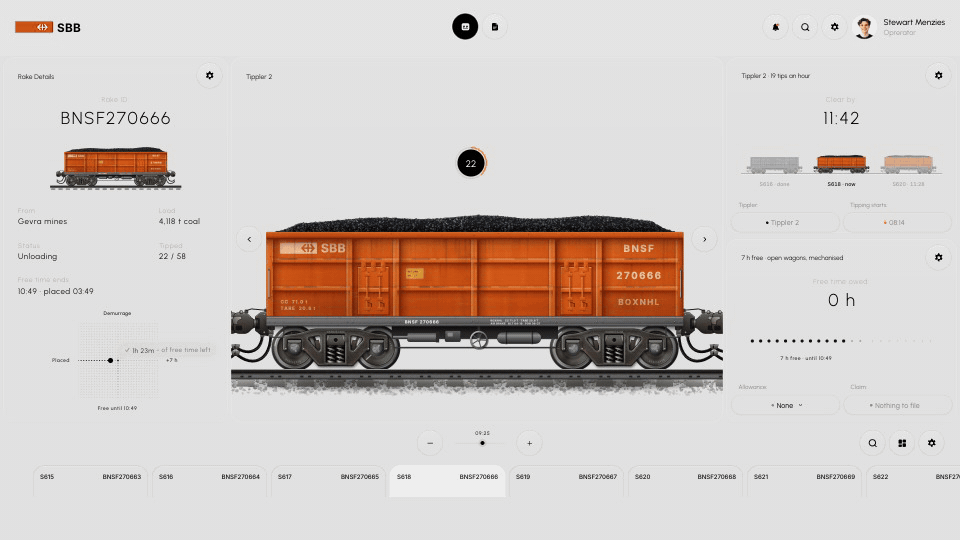
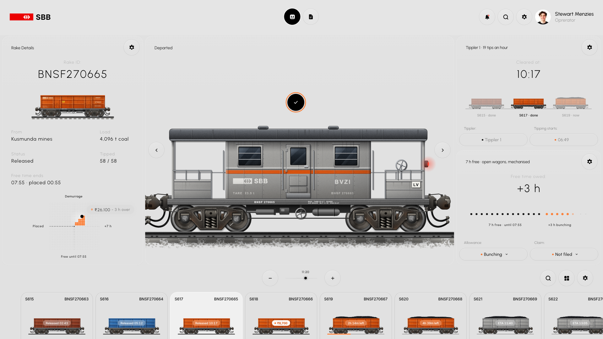
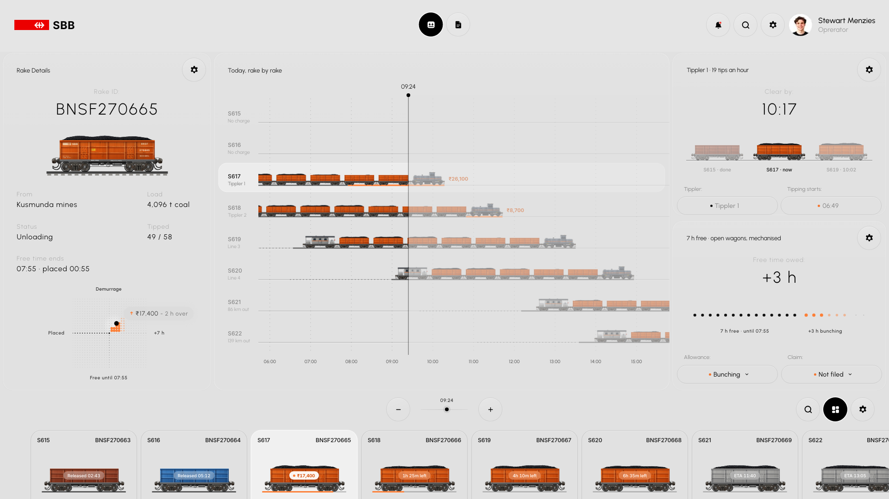
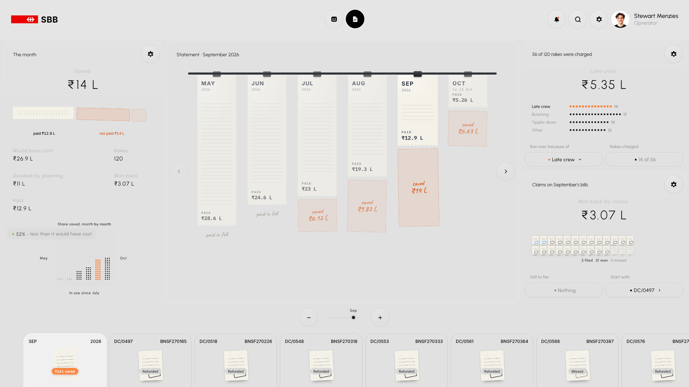
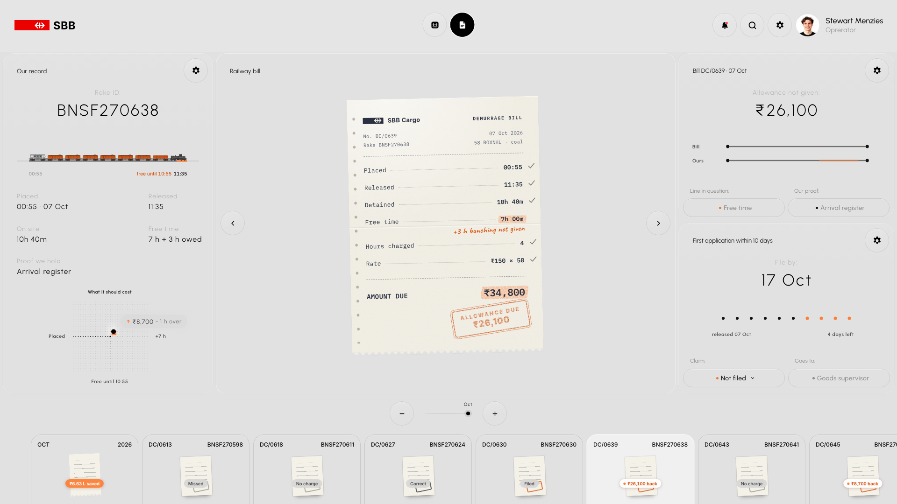
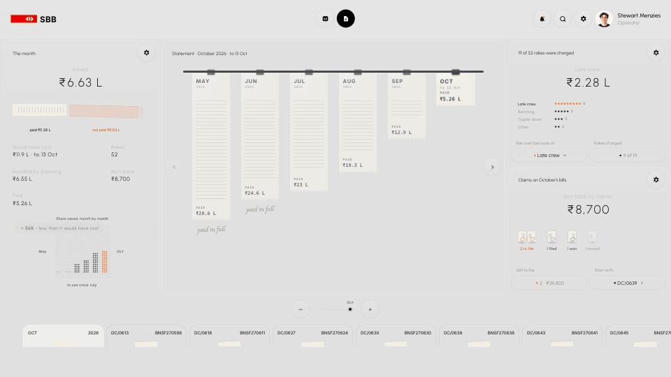

<div align="center">

# SBB

**Every rake has a meter running in rupees. This shows the meter, plans the unloading, and checks the railway's bill.**

A working prototype for the people who run rail sidings at power, steel and cement plants in India. A 58-wagon coal
rake gets seven free hours to unload; after that the railway charges ₹8,700 for every hour or part of one, and more
the longer it stands. SBB plans the day around that clock, and then audits every bill the railway sends against the
plant's own gate and tippler logs.




[build plan](plan.md) · [design reference](design.md) · [market](docs/01-market-evaluation.md) · [customers and pitch](docs/02-customers-and-pitch.md) · [competition](docs/03-competition.md)

</div>

---

## Why this exists

When a goods train is placed at a plant's siding, a clock starts. Unload it inside the free time and it costs
nothing. Run over, and the railway bills **demurrage**: ₹150 per wagon per hour, the whole rake counted as one, any
part of an hour counted as a whole one, and the rate climbing in slabs the longer it stands.

| Hours over | 1 | 3 | 10 | 24 |
|---|---:|---:|---:|---:|
| Bill for one 58-wagon rake | ₹8,700 | ₹26,100 | ₹90,480 | ₹2,40,120 |

Three things make this worse than it needs to be, and each is something software can see:

- **Rakes bunch.** Three arrive within ninety minutes of each other, two tipplers can only take two, and the third
  stands with its meter running. Which rake goes to which tippler, and in what order, decides the bill.
- **Allowances go unclaimed.** The rules give three more free hours when rakes arrive bunched, two for shunting,
  one for tarpaulins. Nobody applies them unless the plant asks.
- **Bills are wrong, and the window is short.** A placement time recorded 34 minutes early can tip a stay into the
  next chargeable hour. The plant has ten days to apply for it back.

SBB is one screen for the day and one for the money, built to make that point to an operator in under five minutes.

## Screens

| | |
|---|---|
|  |  |
| **Yard, a rake that ran over.** S617 has gone, three hours late, and its brake van closes the train. The left panel is the meter: free time used up along the axis, every hour over stacking another block of orange. On the right, the three hours of bunching allowance nobody claimed. | **The day, rake by rake.** The stage's second face. Each rake is a train as long as its stay, on its own track; distance is time. The rail turns orange for every minute past free time, and the cost stands at the head of the train. Drag the slider and the whole yard slides past "now". |
|  |  |
| **Bills, the month.** The months hang as receipts on a rail: as long as what was paid, with what was saved torn off below. Why rakes ran over is a dot per rake; the month's claims are a slip each. | **Bills, one sheet.** The railway's bill is checked in front of you: pencil ticks down the lines that agree with the plant's record, an orange marker and a pen note on the one that does not, then the stamp. The ten-day window is ten dots. |

<div align="center">

<br />
<b>The audit, as it plays.</b> Both recordings are the real page against the real backend, not mock-ups.
</div>

## How it fits together

```
  ┌──────────────────────────────────────────────────────────────┐
  │  the page   wagons, locomotive, paper and stamps drawn in    │  static files, no framework, no build step
  │             code on canvas; two screens, cross-faded         │
  └──────────────────────────────▲───────────────────────────────┘
  ┌──────────────────────────────┴───────────────────────────────┐
  │  player.js   reads a rake's track at the minute the slider   │  the one sum the page does for itself,
  │              is on, so scrubbing needs no round trip         │  tested against the backend's
  └──────────────────────────────▲───────────────────────────────┘
  ┌──────────────────────────────┴───────────────────────────────┐
  │  api · service   FastAPI. Every choice is validated, saved   │  400 invalid · 404 not found · 409 too late
  │                  to a JSON file, and survives a restart      │
  └──────────────────────────────▲───────────────────────────────┘
  ┌──────────────────────────────┴───────────────────────────────┐
  │  schedule · timeline   tippler queues, holds, the cost of a  │  moving one rake re-times every rake
  │                        day, the cheapest assignment          │  behind it, on both tipplers
  └──────────────────────────────▲───────────────────────────────┘
  ┌──────────────────────────────┴───────────────────────────────┐
  │  audit · ledger   one bill against our record; a month of    │  overcharged · allowance not given ·
  │                   them: paid, avoided, won back, missed      │  open · filed · won · missed
  └──────────────────────────────▲───────────────────────────────┘
  ┌──────────────────────────────┴───────────────────────────────┐
  │  rules   the rulebook: hours, slabs, allowances, the meter's │  pure functions, whole rupees,
  │          steps, the ten-day claim window                     │  no clock, no disk
  └──────────────────────────────▲───────────────────────────────┘
  ┌──────────────────────────────┴───────────────────────────────┐
  │  world   one seeded plant, one seeded day of eight rakes,    │  deterministic: the same seed is
  │          and about 650 stays from May to today               │  always the same world
  └──────────────────────────────────────────────────────────────┘
```

**Design principles**

- **The tariff lives in one place.** Rates, slabs and allowances are in `backend/rules.py`. The page holds none of
  them; a test fails if a rate ever appears in the page's scripts.
- **A function of time, not a running loop.** The backend plans the day once into *tracks*: the minutes a rake's
  status changes and the minutes its meter steps. Any moment of the day can be read off a track, which is what makes
  the day scrubbable and the demo repeatable.
- **Visuals before text.** A wagon's colour says where the rake is, its coal says how far it has been tipped, and
  orange appears once per panel, for the thing that costs money. Secondary facts wait behind a hover.
- **Everything is drawn in code.** The wagon, bogies, couplers, locomotive, brake van, coal, paper and stamps are
  procedural, at 64 units to the metre, with seeded weathering. There is one image file in the repo, and it is the
  avatar.

## Highlights

- **A train that moves like one.** Switching wagons rolls the rake along the track on a minimum-jerk curve, with
  sprung bodies, coupler slack and shutter motion blur. Switching rakes sends one train out and brings the next in,
  locomotive first.
- **Re-plan the day from four pills.** Move a rake to the other tippler, hold it back, set the allowance it is owed,
  apply the claim. The backend re-times every rake behind it and the screen follows. The menus show what each choice
  would do before you make it.
- **Too late is an answer.** A rake that has started tipping cannot be moved; a claim whose ten days have run out
  cannot be filed. The backend refuses with a reason and the page says it in one line.
- **The audit is a performance.** Ticks, marker, pen note and stamp land in order on the bill, so the mistake is
  seen being found. Filing or winning the claim restamps the sheet and moves the month's totals.
- **A best plan, already computed.** For every moment of the day the API returns the cheapest assignment of the
  rakes still waiting to the tipplers, and what it would save. It is not on screen yet.
- **Choices are kept.** Everything chosen on screen is saved by the backend. Reload, or restart the server, and the
  day is as you left it. Open the page with `?reset` for a clean one.

## The seeded story

The world is simulated. The six months below are **generated from a seed, not measured at a plant**; they are tuned
to tell the story the product is meant to tell, with the product going in on 1 July.

| | May | Jun | Jul | Aug | Sep | Oct (to the 13th) |
|---|---:|---:|---:|---:|---:|---:|
| Rakes | 124 | 120 | 124 | 124 | 120 | 52 |
| Would have cost | ₹28.6 L | ₹24.6 L | ₹29.1 L | ₹29.1 L | ₹26.9 L | ₹11.9 L |
| Paid | ₹28.6 L | ₹24.6 L | ₹23.0 L | ₹19.3 L | ₹12.9 L | ₹5.3 L |
| Saved | — | — | 21 % | 34 % | 52 % | 56 % |
| Claims missed | 40 | 41 | 28 | 14 | 3 | 1 |

Today's eight rakes are hand-written so the day always has one of everything: two already gone, one three hours
over with an allowance nobody has claimed, one about to cross its free time, two waiting, two still on the way.
Left alone, the day costs ₹34,800.

## Quickstart

You need [uv](https://docs.astral.sh/uv/). It fetches Python and everything else.

```bash
uv run dev
```

That starts both halves and stops them together:

| | | |
|---|---|---|
| the page | http://localhost:5178 | reloads the browser when a page file changes |
| the API | http://localhost:8000 | reloads when backend code changes |

Ports move with `PAGE_PORT` and `API_PORT`; `LIVE=0` turns the browser reload off. The page needs the API: opened on
its own it says the backend is not running and how to start it.

**Things to try**

1. Drag the slider under the stage. The clock runs from the evening before to 18:30; wagons are tipped as it moves.
2. Pick **S617** in the strip. Its meter is running. On the bottom-right card, set the claim to *Applied* and watch
   the charge go.
3. Press the grid button at the bottom right for the day view, then scrub.
4. Pick a waiting rake and move it to the other tippler; the menu says when it would start.
5. Open **Bills**. Press the pill under *Start with* to go to the first bill that can still be claimed, and set its
   claim to *Won*. Go back to the month's card and see the saving move.

## The API

| Method | Path | Returns |
|---|---|---|
| GET | `/api/rules` | the rulebook as data: slabs, allowances, the charge for each hour over |
| GET | `/api/day?at=` | the plant, today's rakes as tracks, the day's cost, the best plan as of `at` |
| GET | `/api/day/state?t=` | every rake at minute `t` |
| GET | `/api/rakes/{slot}/options?at=` | what each tippler and hold choice would do |
| PATCH | `/api/rakes/{slot}` | the re-planned day. Body: any of `tippler`, `hold`, `owed`, `claim`, `livery`, plus `at` |
| GET | `/api/months` | the six months' totals |
| GET | `/api/months/{id}/bills` | that month's bills worth showing, each audited |
| PATCH | `/api/bills/{id}` | the bill and its month. Body: `claim` |
| POST | `/api/reset` | a clean day |

Time is minutes after midnight of the simulated day. Money is whole rupees. Errors are always
`{"error": {"code", "message"}}`.

```bash
curl -s -X PATCH localhost:8000/api/rakes/S617 -H 'content-type: application/json' -d '{"claim": "applied", "at": 564}'
```

## Tests

```bash
uv run pytest
```

497 tests, about fifteen seconds. Every backend suite was written before the code it checks.

| Suite | What it pins down |
|---|---|
| `test_rules` | hours, slabs, rounding, meter steps, the claim window |
| `test_schedule` | queues, holds, the cost of a day; the best plan against a brute-force search |
| `test_timeline` | the whole seeded day minute by minute, and every status edge |
| `test_world` | the generator: shape, determinism, and the month-on-month story, for three seeds |
| `test_books` | the audit of every kind of bill, and months that always balance |
| `test_store` | atomic writes, damaged files, many writers at once |
| `test_service`, `test_api` | every choice, every refusal, every error shape, CORS |
| `test_integration` | the real modules behind the real API on a real file, across a restart |
| `test_page` | the page's own playback script, run under Node, against the backend's sum at more than 80,000 points |
| `test_dev` | what the page server serves, and what it never does |

## Layout

```
index.html  styles.css        the artboard: 1920 × 1080, scaled to the window
art.js  art-stock.js          the artwork: wagon, bogie, coupler, coal, locomotive, brake van
train.js  motion.js           the stage: the rake on its track, and how it moves
board.js  meter.js            the day view, and the dot-matrix meter
app.js  bills.js              the Yard and Bills screens
api.js  player.js  boot.js    the door to the backend, the track player, start-up
backend/                      rules · schedule · timeline · world · audit · ledger · store · service · api · dev
tests/                        one suite per module
docs/                         market, customers, competition
```

**Dev hooks**, as query strings on the page: `?t=10:45` start time · `?speed=0` stop the clock · `?car=3` select a
rake · `?board` open on the day view · `?view=bills` `?month=3` `?step=2` open a month and a bill · `?reset` clean
day · `?vehicle=flatcar` the original container flatcars, kept from the first version.

## What this is not, yet

- **Not live.** There is no FOIS or ULIP feed. One plant, one day and six months of history, all seeded.
- **One assumption to confirm against a real bill:** that a dearer slab applies only to the hours inside it, not to
  the whole overstay. It changes every charge past six hours.
- **Scrubbing back does not undo a choice.** A rake moved at 11:00 stays moved when the clock is dragged to 09:00.
- **Still decoration:** search, the bell, and the cog buttons. The rules drawer they should open is not built.
- **The best plan has no button.** The backend computes it; the Yard does not show it.
- **Unloading only.** Loading, per-wagon weights and a multi-plant view are in [plan.md](plan.md) as what comes next.
- **The name and the flag are placeholders** carried over from the mock-up the interface began as. This project has
  nothing to do with Swiss Federal Railways, and both go before anyone outside sees it.

## Where to read more

- [plan.md](plan.md): what was planned, and section 12, how the backend was specified and built.
- [design.md](design.md): the visual rules every component follows: colour, type, density, motion, artwork.
- [docs/](docs/): who would pay for this, what they say today, and who else is selling to them.
